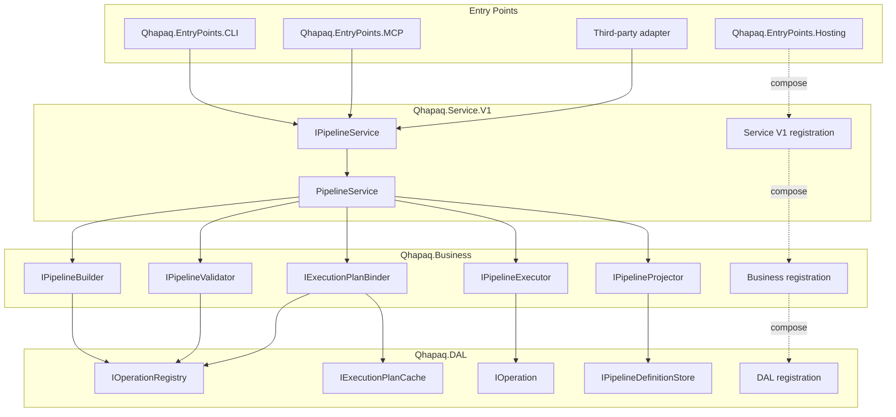

# SPEC-0006: .NET Layered Architecture

> **Status:** Draft
> **Target:** Initial .NET 10 implementation
> **Last updated:** 2026-10-11

## 1. Summary

The .NET reference implementation uses four logical layers:

1. **Entry Points** provide user-facing adapters such as the CLI
   and MCP server.
2. **Service** normalizes every entry point into a common, explicitly versioned
   application contract.
3. **Business** constructs, validates, binds, and executes pipelines through
   reusable domain components.
4. **Data Access Layer (DAL)** provides primitive operations, decorators,
   registries, and low-level adapters used by the business layer.

Production calls move down exactly one layer at a time and cross each boundary
through constructor-injected contracts. The Entry Points layer must
not call Business or DAL components. Service must not call DAL components.
Business must not call Entry Points or Service components.

Each layer has one or more matching .NET assemblies rooted at `Qhapaq`.
Assembly boundaries are independent from the smaller public NuGet package
surface established by
[`0001-core-pipeline-model.md`](0001-core-pipeline-model.md); a NuGet package
may contain multiple Qhapaq assemblies.

## 2. Goals

- Give CLI, MCP, future gRPC, and third-party entry points one consistent
  application boundary.
- Permit breaking application-contract changes through side-by-side service
  versions rather than coordinated changes to every entry point.
- Enforce dependency direction through contracts, dependency injection,
  visibility, assembly references, and architecture tests.
- Make the owning layer apparent from every production assembly and root
  namespace.
- Keep pipeline construction and execution rules reusable and independent of
  transports and hosts.
- Minimize the public .NET API while preserving supported operation authoring
  and third-party entry-point scenarios.
- Preserve the portable, language-neutral contracts defined by the root
  specifications and schemas.

## 3. Non-goals

- This specification does not make internal .NET layer contracts portable
  Qhapaq contracts.
- It does not define the normative CLI, MCP, or future gRPC wire protocols.
- It does not create separate public `Service`, `Business`, or `DAL` packages.
- It does not permit declarative documents to select implementation types.
- It does not introduce remote execution, durable runs, or implicit operation
  version selection.

## 4. Layer Responsibilities

### 4.1 Entry Points

Entry Points are transport and hosting adapters at the top of the call graph.
Initial entry points are the `qhapaq` CLI and MCP server, implemented by
`Qhapaq.EntryPoints.CLI` and `Qhapaq.EntryPoints.MCP`; future entry points may
include `Qhapaq.EntryPoints.GRPC` or application-specific adapters.

**[R-0006-001]** Each implementation:

- parses and authenticates its transport-specific request;
- maps that request to one exact version of the public Service contract;
- invokes only that Service contract;
- maps the Service result or structured failure to its own protocol; and
- contains no pipeline construction, binding, policy, or execution rules.

**[R-0006-002]** `Qhapaq.EntryPoints.Hosting` is the .NET hosting and composition adapter
used by entry points. It invokes the public Service V1 composition entry point
and must not reference or register Business or DAL components directly.

### 4.2 Service

**[R-0006-003]** Service is the common application boundary. It coordinates complete use cases
such as constructing, validating, visualizing, and executing a pipeline. It
normalizes entry-point inputs, applies application-level validation, invokes
Business contracts, and translates domain outcomes into stable service
outcomes.

**[R-0006-004]** Service contracts are versioned independently from NuGet packages, pipeline
document versions, and operation versions. Initial public contracts use the
`Qhapaq.Abstractions.Service.V1` namespace, and their implementation uses the
`Qhapaq.Service.V1` assembly and root namespace. A breaking contract change
adds a new contract namespace and side-by-side implementation assembly, such
as `Qhapaq.Service.V2`; it must not silently change V1 behavior.

**[R-0006-005]** The Service contract is public because third parties may create their own entry
points. It is an advanced integration boundary rather than a transport
protocol. Service implementations are internal and obtained through supported
dependency-injection registration.

### 4.3 Business

**[R-0006-006]** Business owns domain behavior that is independent of an entry point:

- pipeline construction and higher-level composition;
- semantic validation and type compatibility;
- definition-to-plan binding;
- policy evaluation orchestration;
- execution-plan and run coordination;
- canonical definition projections; and
- deterministic visualization and invocation-skill generation.

**[R-0006-007]** Business accepts only Service-to-Business abstraction types and calls only
Business-to-DAL abstraction types. It must not parse CLI arguments, MCP
messages, or other transport envelopes.

### 4.4 Data Access Layer

**[R-0006-008]** DAL is the lowest implementation layer. It owns:

- primitive `IOperation<TInput, TOutput>` implementations;
- operation decorators and wrappers;
- operation and decorator registration and exact-version lookup;
- low-level definition, plan-cache, and host-configuration adapters; and
- external resource adapters used by operations.

**[R-0006-009]** DAL does not make application-use-case decisions and does not call Business,
Service, or Entry Point components. A primitive operation package
continues to depend only on `Qhapaq.Abstractions`.

## 5. Contract Placement and Visibility

**[R-0006-010]** All cross-layer interfaces and boundary object types are defined in
`Qhapaq.Abstractions`. Their visibility follows least exposure:

| Contract category | Visibility | Consumers |
| --- | --- | --- |
| Versioned Service interfaces, requests, results, and structured errors | `public` | Built-in and third-party Entry Points |
| Operation execution and static descriptor-authoring contracts and essential operation value types | `public` | Primitive operation and decorator authors |
| Service-to-Business contracts and values | `internal` | Qhapaq implementation assemblies and tests |
| Business-to-DAL contracts and values | `internal` | Qhapaq implementation assemblies and tests |
| Concrete Service, Business, and DAL types | `internal` | Owning-layer registration and tests |

**[R-0006-011]** `InternalsVisibleTo` may grant named Qhapaq implementation and test assemblies
access to internal contracts. It must not grant access to third-party
assemblies, use a wildcard, or become a substitute for a deliberately public
contract.

**[R-0006-012]** Public contracts must not expose internal contract types, concrete
implementation types, dependency-injection container types, transport types,
or mutable implementation state. Portable JSON and protocol semantics remain
defined by schemas and language-neutral specifications rather than these CLR
types.

### 5.1 Definition-to-execution model ownership

This map refines R-0006-010 through R-0006-012 for the model families required by
[SPEC-0007 R-0007-346](0007-portable-pipeline-definitions-and-binding.md#net-organization-and-portable-validation).
Ownership describes responsibility, not an exhaustive class catalogue. Portable
JSON remains the contract authority; no public .NET syntax tree is implied.

**[R-0006-035]** Model ownership and exposure follow this map:

| Model family | Owning responsibility | Supported public values | Internal boundary values and layer-private representations |
| --- | --- | --- | --- |
| Definition | Business owns inert parsing, structural validation, construction, and normalization; DAL owns definition storage adapters. | Canonical JSON or a projection explicitly required by a versioned Service contract; no public parsed-definition object model. | Only the definition input, immutable snapshot, or storage value required by an adjacent port belongs in internal Abstractions. Parsed node graphs and normalization working state stay in Business; storage records stay in DAL. |
| Schema | Business owns domain schema interpretation, propagation, and compatibility decisions. | Immutable schema content needed by the supported descriptor or Service projection; no public validation or inference engine model. | Adjacent ports carry only required immutable schema values. Normalized analysis forms, inference state, and native-binding analysis stay with their owning implementation. |
| Expression | Business owns inert mapping syntax, scope/dominance analysis, inference, and bound evaluation representations. | Mapping JSON only where a supported public contract requires it; no public expression object model or internal missing-value sentinel. | Only required immutable expression inputs or analysis summaries cross internal ports. Syntax graphs, inferred value states, compiled accessors, and evaluation state remain layer-private. |
| Descriptor | DAL owns effective-registry entries and exact metadata lookup; Business owns domain use of the selected contract; Service owns its disclosure-safe application projection. | The immutable `OperationDescriptor` and essential nested descriptor values required by static operation declarations and Service retrieval. | Registry selection, provenance, integrity, conflict, native-binding, factory, and policy context use internal port values. None becomes a public member merely because it accompanies a public descriptor internally. |
| Bound plan | Business owns complete validation, binding, execution coordination, and compiled plans; DAL owns plan-cache adapters. | No public bound-plan, factory, serializer, or execution-frame model. A supported Service contract may return its specified safe analysis/result projection. | Any plan reference or cache value actually required by an adjacent port is an internal Abstractions contract. Concrete compiled graphs remain Business-owned; DAL treats cached derived state as opaque and cannot establish validity or execute it. |
| Failure and diagnostic | Each layer owns failures arising from its context; Business owns runtime failure control, aggregate/recovery causality, and caught-failure projection. | Only essential values required by supported operation contracts and the specified safe Service diagnostic, runtime-failure, and structured-error projections. | Internal outcomes retain the context needed by adjacent collaborators. Exceptions, protected diagnostics, complete internal causal state, and run/frame state stay layer-private; they are not public error details. |
| Service boundary | Service owns complete application requests, responses, conclusions, errors, and domain-to-Service translation. | Explicitly versioned immutable interfaces and values in public Service Abstractions, including the exact descriptor-retrieval contracts. | Service-to-Business requests and outcomes are internal Abstractions contracts, not the public Service DTOs reused as domain contracts. Transport envelopes stay in Entry Points; concrete Service types stay internal. |

Here, layer-private means a representation not used as a cross-layer contract:
its implementation type remains non-public in the owning assembly. It does not
require a separate assembly or a particular nested-type syntax. A value actually
crossing a layer boundary must instead satisfy R-0006-010 even when its contents
are opaque. The map introduces no new operation failure-reporting API and does
not expand the supported strongly typed operation-composition contracts.

**[R-0006-036]** Boundary values expose only immutable data or narrowly scoped
contracts needed by the receiving adjacent collaborator. Internal contracts are
placed in `Qhapaq.Abstractions.Internal.Business` for Service-to-Business and
`Qhapaq.Abstractions.Internal.DAL` for Business-to-DAL. Public descriptor,
operation-authoring, and versioned Service values remain in their established
public contract namespaces. Every nested type reachable through a public API
must itself be a supported public contract; it must not expose an internal
schema/expression graph, compiled plan, implementation type, or mutable state.

Service translates internal outcomes into its specified public projections;
Entry Points preserve those projections rather than recomputing domain rules.
Runtime failures, validation diagnostics, Service operation errors, and the
lexically scoped caught-failure projection remain distinct as required by
SPEC-0007. Public visibility of a descriptor or failure value never authorizes
lookup, execution, or payload disclosure. Private execution frames never become
operation contexts or publicly inspectable result stores.

### 5.2 Representative ownership and dependency flows

**[R-0006-037]** The first model-dependent slices preserve these flows:

- **Exact descriptor retrieval:** an Entry Point maps its transport selector to
  the public Service request. Service validates the complete selector and calls
  an internal Business port. Business coordinates exact metadata selection and
  disclosure policy through internal DAL ports. DAL supplies immutable selected
  metadata and required internal lookup context without constructing operations.
  Business returns an internal outcome; Service projects the normal result or
  structured error defined by SPEC-0007 R-0007-404 through R-0007-410. Entry
  Points consume only that Service response. Protected lookup/policy context
  never enters an unavailable response, and descriptor visibility does not
  permit Entry Points to call the registry.
- **Inert parsing:** Service passes the supplied definition input through an
  internal Business port. Business constructs its inert definition, schema,
  and expression representations and performs the promised structural checks
  without registry resolution, operation construction, or execution. Only the
  required internal snapshot or safe analysis outcome returns to Service;
  Service projects diagnostics and the stage-aware conclusions required by
  SPEC-0007 R-0007-400 through R-0007-403. Successful parsing is not complete
  document validity, binding, normalization, or invocation permission.
- **Descriptor generation:** the build-time generator reads explicit descriptor
  inputs and compiler symbols, validates offline, and emits the established
  public static declaration and registration projections. Its compiler-symbol,
  source-location, and build-diagnostic models remain tooling-local, not
  runtime layer contracts or public Service values. It neither instantiates
  operations nor obtains a runtime Service, registry, plan, or execution frame.
  Runtime registry verification still occurs independently through DAL.

These flows assign model responsibilities only. Shared portable algorithm
ownership and the generator/runtime shared-library dependency boundary require
their separate reviewed decisions before implementation. They cannot be inferred
from a model's owner, and no new project, package, or layer exception is selected
here.

**[R-0006-038]** Architecture and package-consumer tests for these model families
must reject public signatures exposing internal or concrete engine types,
cross-layer models outside Abstractions, transport or compiler models leaking
into runtime contracts, and non-adjacent calls or dependencies. Tests cover
recursive public-signature reachability, including nested descriptor and schema
values and generic type arguments, not only top-level DTO visibility. Clean
operation-authoring and third-party Service consumers must use only supported
public contracts without friend access. Behavioral slice tests verify inert
parsing, non-executing descriptor retrieval, safe failure/conclusion projection,
and offline non-executing generation. Required tests are delivered with real
models and collaborators, not speculative placeholder types.

### 5.3 Portable helper semantic ownership

The portable behavior in SPEC-0007 R-0007-348 remains authoritative. This map
assigns .NET semantic ownership and permitted consumers; it does not select a
project, assembly, or package boundary.

**[R-0006-039]** Business owns the .NET semantics for strict JSON parsing and
duplicate-member rejection; RFC 8785 canonicalization and digest computation;
exact offline document-schema selection; the embedded schema profile,
reference, cycle, and complexity validation; bounded patterns and closed
formats; descriptor and vocabulary validation; canonical contract-digest
verification; and portable validation findings. Runtime callers use these
semantics through Business behavior and adjacent-layer contracts: Service and
Entry Points do not call helper implementations directly, and DAL supplies or
stores metadata without deciding its domain validity. All consumers preserve
the deterministic, culture/path-independent outcomes required by SPEC-0007
R-0007-348. Build-time tooling may consume the same semantics only through an
explicit, reviewed dependency boundary, without a second implementation of the
algorithms, network access, operation construction, or project-code execution.
Portable findings remain bounded and payload-safe; build tooling maps them to
build diagnostics, while runtime callers preserve the distinct Business,
Service, and transport
diagnostic envelopes. Architecture and consumer tests enforce the ownership,
permitted-consumer, and no-layer-bypass rules. The physical dependency boundary
for build-time tooling is decided separately and must preserve this ownership
map.

**[R-0006-041]** Consistent with R-0006-020 and R-0006-039, the .NET reference
implementation shares the portable algorithms in SPEC-0007 R-0007-348 through
one narrowly scoped production project and library assembly named
`Qhapaq.Portable.Validation`, located at
`src/common/dotnet/src/Qhapaq.Portable.Validation/`. Its `AssemblyName` and
`RootNamespace` match its project name. Business references this assembly for
runtime behavior, and the Roslyn generator consumes the same implementation
only as build-time tooling. The assembly is bundled in the `Qhapaq` runtime
distribution and as a private build-time asset of the generator package; it
does not create a separate public package. The shared assembly does not depend
on Business, DAL, Service, Entry Points, the generator, runtime hosting, or
project code. Reviewed low-level dependencies are permitted when needed,
provided they preserve deterministic offline behavior and do not introduce
network access, operation construction, credential resolution, or project-code
execution. Generator packaging keeps the generator and dependencies used only
by it out of a consuming application's runtime dependency closure; the shared
assembly may be present through runtime references such as Business.
Architecture and clean package-consumer tests enforce dependency direction and
build-time/runtime asset separation. This physical boundary does not transfer
logical semantic ownership or diagnostic responsibilities from Business.

### 5.4 Representative type relationships

**[R-0006-040]** Business models pipeline-node syntax and mapping-expression
syntax as separate, closed internal variant families corresponding to their
supported language forms. Recursive node and expression structure uses
composition. A family has a shared internal root only where its variants share
a semantic invariant or operation required by their consumers. Inert definition,
node, and expression representations remain distinct from bound-plan and
compiled execution state; they are not base types for those representations.
These models remain layer-private and do not cross public or Abstractions
boundaries. This requirement selects conceptual relationships, not exact type
names, file organization, or an exhaustive type catalogue.

## 6. Dependency and Composition Rules

**[R-0006-013]** Each component receives required collaborators through constructor injection.
Service location, ambient mutable state, and runtime type-name activation are
prohibited.

**[R-0006-014]** The allowed runtime call graph is:

```text
Entry Point -> Service -> Business -> DAL
```

**[R-0006-015]** The allowed contract dependencies are:

```text
Entry Point             -> public Service contracts
Service                -> internal Service-to-Business contracts
Business               -> internal Business-to-DAL contracts
DAL                    -> public operation contracts and platform abstractions
```

**[R-0006-016]** The .NET implementation uses `Microsoft.Extensions.DependencyInjection` as
decided by
[ADR-0001](../docs/architecture/decisions/0001-use-microsoft-dependency-injection.md).
Composition APIs use `IServiceCollection`; behavioral components must not
depend on `IServiceCollection`, `IServiceProvider`, or `IServiceScopeFactory`.
`Qhapaq.Abstractions` must not expose Microsoft DI types.

**[R-0006-017]** Composition follows the same adjacent-layer direction as runtime behavior:

```text
Qhapaq.EntryPoints.Hosting
    -> Qhapaq.Service.V1 registration
    -> Qhapaq.Business registration
    -> Qhapaq.DAL registration
```

**[R-0006-018]** Each layer registers its own internal concrete types, exposes only its boundary
abstractions for resolution, and delegates registration only to the immediately
lower layer. Hosting must not reference Business or DAL. Service must not
reference DAL. The Service V1 registration entry point is public so supported
hosting adapters can compose the versioned Service boundary. Business and DAL
registration entry points remain internal and are visible only to the named
adjacent Qhapaq assembly and tests.

**[R-0006-019]** Only an executable or hosting boundary may build or directly access the root
`IServiceProvider`. Registration methods must not build a nested provider,
resolve services, or invoke product behavior. Registration is explicit rather
than reflection-based assembly scanning. Hosts enable build and scope
validation in development and automated tests.

**[R-0006-020]** Cross-cutting concerns belong at the lowest layer that has the required
context. Transport diagnostics stay in Entry Points, use-case
diagnostics stay in Service, domain diagnostics stay in Business, and
operation-specific diagnostics stay in DAL. Policy enforcement must not be
implemented only in a transport adapter.

## 7. Assemblies and Distribution Packages

The table below describes the initial runtime-layer assemblies. The shared
portable-validation support assembly is specified separately by R-0006-041.

**[R-0006-021]** Every production project sets `AssemblyName` and `RootNamespace` to its project
name. Initial production assemblies are:

| Assembly and root namespace | Layer | Distribution |
| --- | --- | --- |
| `Qhapaq.Abstractions` | Contracts shared across adjacent layers | `Qhapaq.Abstractions` NuGet package |
| `Qhapaq.Portable.Validation` | Shared portable-validation support | Bundled in `Qhapaq`; private build-time asset of the generator package |
| `Qhapaq.Service.V1` | Service V1 | Bundled in the `Qhapaq` NuGet package |
| `Qhapaq.Business` | Business | Bundled in the `Qhapaq` NuGet package |
| `Qhapaq.DAL` | DAL | Bundled in the `Qhapaq` NuGet package |
| `Qhapaq.EntryPoints.Hosting` | Entry Points and composition | `Qhapaq.Hosting` NuGet package |
| `Qhapaq.EntryPoints.MCP` | Entry Points | `Qhapaq.Mcp` NuGet package and MCP host distribution |
| `Qhapaq.EntryPoints.CLI` | Entry Points | Self-contained `qhapaq` executable distribution |

**[R-0006-022]** The `Qhapaq` NuGet package is a distribution package and does not require a
`Qhapaq.dll` facade assembly. Similarly, package names may remain stable when
their contained implementation assembly has a more precise layer-aligned name.
Adding a public package for an internal layer remains a separate compatibility
decision.

**[R-0006-023]** Future entry-point directories, projects, assemblies, root
namespaces, and derived source namespaces use the
`Qhapaq.EntryPoints.<EntryPoint>` pattern. A production directory and project
file use the same name as their assembly and root namespace. Executable file
names and distribution package IDs are separate identities and need not match
the project name. Future breaking Service
versions use `Qhapaq.Service.V<Major>`. `CLI`, `MCP`, `DAL`, and similarly
established initialisms retain their canonical uppercase spelling in assembly
and root namespace names.

## 8. Initial .NET Project and File Plan

The project tree below describes the initial runtime layers. The shared
validation project and its tests live in the separate common .NET workspace
shown after the implementation tree and are specified in R-0006-041.

**[R-0006-024]** The initial project structure is:

```text
implementations/dotnet/
|-- Qhapaq.slnx
|-- Directory.Build.props
|-- Directory.Packages.props
|-- global.json
|-- src/
|   |-- Qhapaq.Abstractions/
|   |   |-- Qhapaq.Abstractions.csproj
|   |   |-- Operations/
|   |   |   |-- IOperation.cs
|   |   |   `-- Declarations/
|   |   |-- Service/V1/
|   |   |   |-- IPipelineService.cs
|   |   |   |-- Requests/
|   |   |   `-- Results/
|   |   `-- Internal/
|   |       |-- Business/
|   |       `-- DAL/
|   |-- Qhapaq.Service.V1/
|   |   |-- Qhapaq.Service.V1.csproj
|   |   `-- PipelineService.cs
|   |-- Qhapaq.Business/
|   |   |-- Qhapaq.Business.csproj
|   |   |-- Construction/
|   |   |-- Validation/
|   |   |-- Binding/
|   |   |-- Execution/
|   |   `-- Projection/
|   |-- Qhapaq.DAL/
|   |   |-- Qhapaq.DAL.csproj
|   |   |-- Operations/
|   |   |-- Decorators/
|   |   |-- Registries/
|   |   `-- Persistence/
|   |-- Qhapaq.EntryPoints.Hosting/
|   |   |-- Qhapaq.EntryPoints.Hosting.csproj
|   |   `-- DependencyInjection/
|   |-- Qhapaq.EntryPoints.MCP/
|   |   |-- Qhapaq.EntryPoints.MCP.csproj
|   |   `-- Service/
|   `-- Qhapaq.EntryPoints.CLI/
|       |-- Qhapaq.EntryPoints.CLI.csproj
|       |-- Commands/
|       `-- Service/
`-- tests/
    |-- unit/
    |   |-- Qhapaq.Architecture.Tests/
    |   |-- Qhapaq.Service.V1.Tests/
    |   |-- Qhapaq.Business.Tests/
    |   `-- Qhapaq.DAL.Tests/
    `-- integration/
        |-- Qhapaq.EntryPoints.Hosting.Tests/
        |-- Qhapaq.EntryPoints.MCP.Tests/
        `-- Qhapaq.EntryPoints.CLI.Tests/
```

The shared library has its own language workspace and tests:

```text
src/common/dotnet/
|-- src/
|   `-- Qhapaq.Portable.Validation/
|       `-- Qhapaq.Portable.Validation.csproj
`-- tests/
```

**[R-0006-025]** Assembly references provide the primary structural boundary. Folder names and
namespaces communicate ownership within each assembly. Additional files should
be introduced only with behavior and tests, not as empty placeholders.

## 9. Initial Components

**[R-0006-026]** The names below define responsibilities and relationships for the initial
scaffold. Exact method and DTO shapes remain governed by the use-case and
protocol specifications created before implementation.

| Layer | Initial component | Responsibility |
| --- | --- | --- |
| Entry Points | `Qhapaq.EntryPoints.CLI` commands | Map command input and output to Service V1 |
| Entry Points | `Qhapaq.EntryPoints.MCP` handlers | Map MCP requests and results to Service V1 |
| Entry Points | `Qhapaq.EntryPoints.Hosting` registrations | Compose and expose the supported Service boundary |
| Service | `IPipelineService` V1 | Public entry-point contract for pipeline use cases |
| Service | `PipelineService` V1 | Coordinate validation, construction, visualization, and execution |
| Business | `IPipelineValidator` | Apply semantic and type-compatibility validation |
| Business | `IPipelineBuilder` | Construct immutable pipeline definitions and higher-level compositions |
| Business | `IExecutionPlanBinder` | Bind an exact validated definition to an immutable plan |
| Business | `IPipelineExecutor` | Coordinate one non-durable run |
| Business | `IPipelineProjector` | Produce deterministic Mermaid and skill projections |
| DAL | `IOperationRegistry` | Resolve allowlisted operations and decorators by exact identity and version |
| DAL | `IPipelineDefinitionStore` | Persist and retrieve canonical definitions |
| DAL | `IExecutionPlanCache` | Cache derived bound plans without making them portable |
| DAL | `IOperation<TInput, TOutput>` | Execute a primitive or type-preserving decorated operation |

**[R-0006-027]** The declaration contracts planned under `Operations/Declarations/` let
registry-visible code-authored operations expose a static portable descriptor
without construction. A marker attribute may support analyzers and source
generators, but registration remains explicit and reflection-free. Exact API
shapes are governed by
[`0007-portable-pipeline-definitions-and-binding.md`](0007-portable-pipeline-definitions-and-binding.md)
and remain to be designed before implementation.

## 10. Component Diagram

**[R-0006-028]** The maintainable diagram source is
[`../docs/architecture/diagrams/dotnet-layered-components.mmd`](../docs/architecture/diagrams/dotnet-layered-components.mmd).



**[R-0006-029]** Solid arrows are permitted runtime calls. Dotted arrows are composition-time
delegation between adjacent layers and do not permit direct behavioral calls.

## 11. Enforcement and Testing

**[R-0006-030]** The initial scaffold must include architecture tests that fail when:

- `Qhapaq.EntryPoints.*` references `Qhapaq.Business` or `Qhapaq.DAL`;
- `Qhapaq.Service.V1` references `Qhapaq.DAL`;
- `Qhapaq.Business` references `Qhapaq.Service.*` or `Qhapaq.EntryPoints.*`;
- `Qhapaq.DAL` references any higher-layer assembly;
- a production assembly or root namespace does not match its project name;
- a concrete lower-layer type is public;
- an internal abstraction is exposed by a public API;
- an entry point resolves a Business or DAL contract from dependency injection;
- behavioral code depends on `IServiceCollection`, `IServiceProvider`, or
  `IServiceScopeFactory`;
- a registration method builds or resolves from a service provider; or
- a complete graph fails Microsoft DI build or scope validation.

**[R-0006-031]** Unit tests remain aligned to their owning layer. Integration tests begin at a
supported Entry Point or the public Service boundary and verify
cross-layer behavior without bypassing a boundary. Package-consumer tests must
prove that third-party operation libraries need only `Qhapaq.Abstractions` and
that third-party entry points can consume Service V1 without accessing internal
Business or DAL contracts.

## 12. Security, Compatibility, and Failure Handling

**[R-0006-032]**

- Every Entry Point must preserve authentication, authorization,
  policy, and disclosure decisions returned by Service; it must not weaken them
  during protocol mapping.
- Complete validation and policy checks occur before Business begins side
  effects.
- Requests, results, errors, and cancellation flow through every layer without
  success-shaped fallbacks or broad exception swallowing.
- Service versions coexist when compatibility requires it. Removing a version
  requires a documented support and migration policy.
- Layer refactoring must not change portable document or protocol behavior
  without updating the governing language-neutral specification and
  conformance data.
- Internal contracts may change with the implementation package, provided all
  built-in layers are updated together and observable behavior is preserved.

## 13. Rollout

**[R-0006-033]**

1. Scaffold `Qhapaq.Abstractions`, `Qhapaq.Service.V1`, `Qhapaq.Business`,
   `Qhapaq.DAL`, `Qhapaq.EntryPoints.Hosting`,
   `Qhapaq.EntryPoints.MCP`, `Qhapaq.EntryPoints.CLI`, and their test
   projects.
2. Add architecture tests before implementing cross-layer behavior.
3. Define the smallest Service V1 use case and its public request, result, and
   error contracts.
4. Add Business and DAL ports required by that use case.
5. Implement and test one vertical slice through CLI and the public Service
   boundary before expanding the API.

**[R-0006-034]** No artifact-plan item is complete merely because its directory or placeholder
type exists.

## 14. Alternatives Considered

### Public package per layer

Rejected for the initial implementation. Physical assembly boundaries enforce
the architecture without exposing unsupported Business and DAL packages or
expanding package compatibility obligations.

### One assembly for Service, Business, and DAL

Rejected. Namespace-only separation would not make assembly references match
the layers and would provide weaker compile-time dependency enforcement.

### Entry points call Business directly

Rejected. Transport-specific behavior would become coupled to domain
implementation details, and versioned Service compatibility could not protect
entry points.

### Service Implementations or Adapters as the top-layer name

Rejected. "Service Implementations" overloads "implementation" between a
language runtime and a .NET layer, while "Adapters" is too broad because DAL
also owns low-level and external-resource adapters. "Entry Points" names the
layer by its responsibility. The matched `Qhapaq.EntryPoints.*` project,
assembly, root-namespace, and source-namespace identity keeps ownership
apparent; executable and distribution package names remain separate identities.

### Put layer contracts beside their implementations

Rejected. It would reverse dependencies or require higher layers to reference
lower implementation assemblies. Centralizing contracts in
`Qhapaq.Abstractions` keeps dependency direction explicit while visibility
limits unsupported use.

### One unversioned Service contract

Rejected. A breaking service change would require every built-in and
third-party entry point to migrate in lockstep.

## 15. Open Questions

The first vertical-slice specification must decide:

- the exact Service V1 use case with which implementation begins;
- the public Service V1 request, result, and structured-error shapes.

These decisions must be recorded before their public APIs are scaffolded.
